

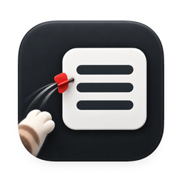

# MenuDart

**See every app menu and every menu bar icon in a popup, even the ones that don't fit on your screen.**

English | [한국어](README.ko.md)

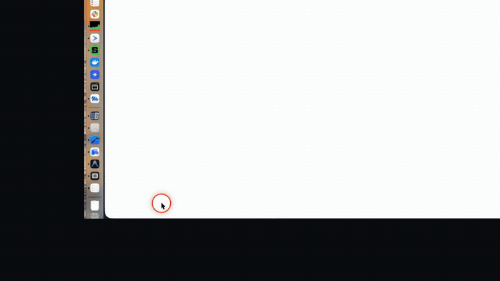

## Why MenuDart

On a small screen like a MacBook's, a menu bar runs out of room quickly. An app's menus don't all fit, and when many apps are running, their menu bar icons overflow and some end up hidden. The notch makes it worse.

  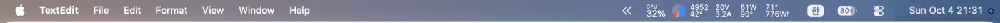

My MacBook's menu bar. I have 18 menu bar icons. Only these few are visible; macOS tucks the rest behind the « button.

I'm the developer. I had been using another menu bar icon manager, but after I updated to macOS 27 Golden Gate it started behaving strangely. So I built my own, with a different approach. Instead of rearranging or hiding things inside the menu bar, MenuDart shows the menus and the icons in a popup, which doesn't depend on how the menu bar lays itself out.

I also wanted an icon's own menu to open somewhere more convenient, but I couldn't find a reliable way to do that. So MenuDart lets the menu open where it normally does and moves your pointer there for you.

## Watch the demo

A 50-second walkthrough: a cramped MacBook menu bar, an ultrawide monitor, both shortcuts, and the dart that carries the pointer to the menu you pick.

  <a href="https://youtu.be/BC-k86lHgMM">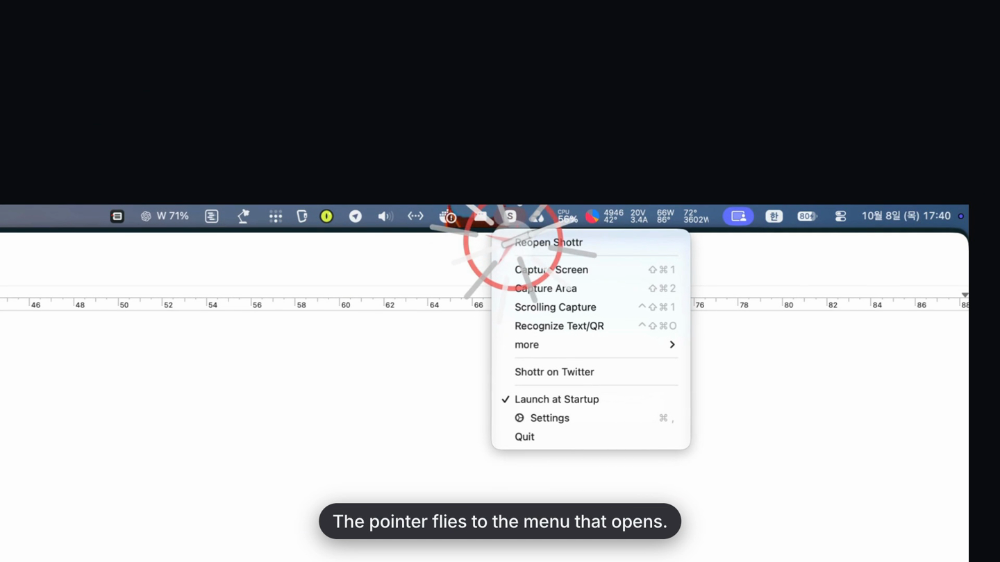</a>

<a href="https://youtu.be/BC-k86lHgMM">▶ Watch the demo on YouTube</a>

## What it does

MenuDart opens two popups from global keyboard shortcuts. You can also open either one from the MenuDart icon in the menu bar.

### App Menus

Shows the frontmost app's menu bar menus (Apple menu, File, Edit, and so on) in a popup next to the pointer. It works even when the menu titles don't fit in the menu bar.

  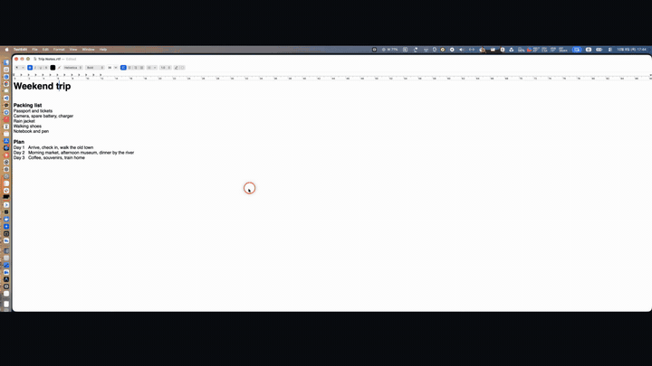

  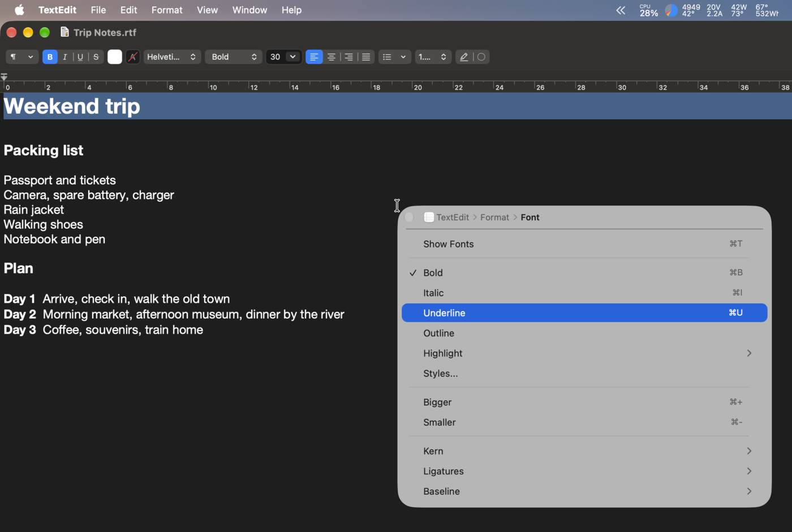

- Submenus open in place. A breadcrumb with the app's icon (TextEdit › Format › Font) shows where you are and lets you jump back to an earlier level.
- It looks like a system menu, including disabled items and separators. Each action appears once (Option-key alternates are hidden).
- The popup doesn't take focus from the app you're working in, so that app's menu bar stays as it is.

**Outline layout and menu search.** Switch Settings → App Menu → **Layout** from Classic to **Outline** to see every menu as one tree you can expand and collapse. Start typing and MenuDart searches every menu item, submenus included, and shows the menus each one lives in (Format › Font). Case and accents are ignored, and Korean initial consonants work too. Press <kbd>→</kbd> to show a result in the tree, or <kbd>Return</kbd> to run it. The Apple button next to the search field (or **Include Apple Menu in Search** in Settings) chooses whether the Apple menu is searched.

  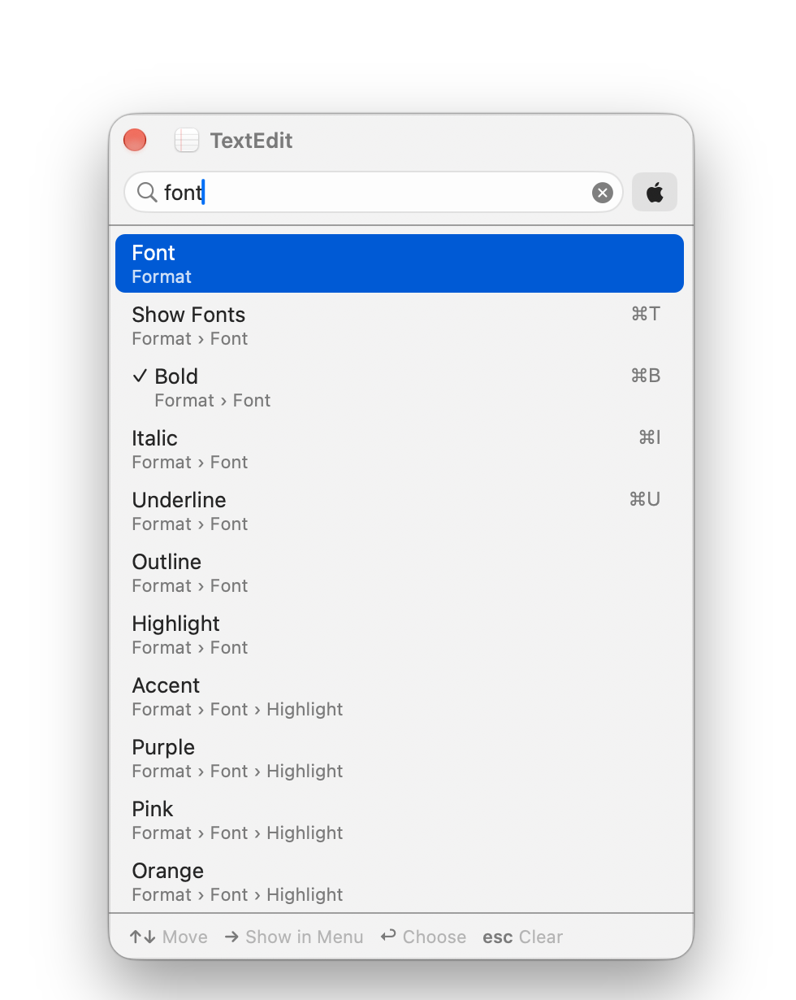

### Menu Bar Icons

Gathers the icons on the right side of the menu bar (status items and menu extras, including Control Center ones) into a grid, including icons hidden because the menu bar is too crowded or cut off by the notch.

  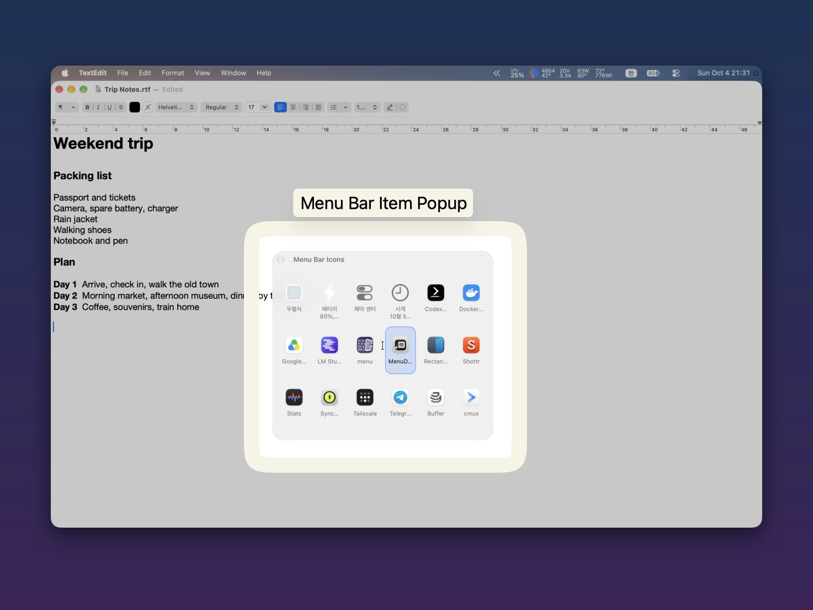

- Pick an icon with the arrow keys or the pointer. MenuDart clicks the real icon for you, with a left click or a right click.
- Start typing as soon as the popup opens to narrow the grid by icon or app name. The first match is selected, so <kbd>Space</kbd> or <kbd>Return</kbd> opens it right away. Korean initial consonants work too (ㅅㄱ finds 시계).
- Icons built into macOS (Control Center, Wi‑Fi, battery, clock and so on) are listed first by name, then other apps' icons by app name, so the order stays the same every time. Turn off **Show Built-in macOS Icons** in Settings → Menu Bar Icons to list only other apps' icons.
- If clicking an icon changes nothing, a small toast in the popup tells you.
- Turn off **Show Icon Names** in Settings → Menu Bar Icons to show the icons alone, like the Dock. Point at an icon to see its name.
- While the list refreshes, Coco the cat looks through the menus in the popup's title bar, then curls up for a nap when it's done.

**How the pointer flight works.** After you pick an icon, its own menu still opens at its normal place under the menu bar. MenuDart does not move that menu and does not show it inside the popup. What it does is move your pointer onto the menu once it has opened, so you don't have to travel to the top of the screen. You can choose a pointer effect for the trip: Rocket, Trail, Dart, Ddoee (a flying cat), or No Effect.

  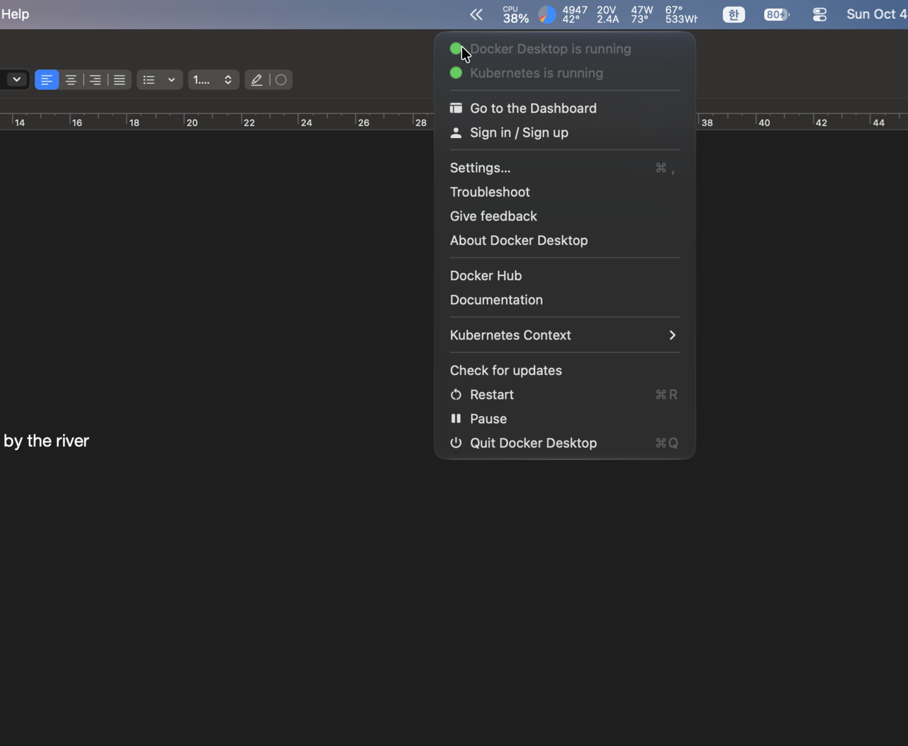

### ⌘Tab app switcher (optional)

The macOS app switcher puts every open app in one row, which gets cramped on a small screen with many apps open. Turn on **Use MenuDart for ⌘Tab** in Settings → Shortcuts and <kbd>⌘</kbd><kbd>Tab</kbd> shows your open apps in several rows on a glass panel, centred on the screen with the pointer. It is off until you turn it on, and turning it off brings back the macOS switcher.

  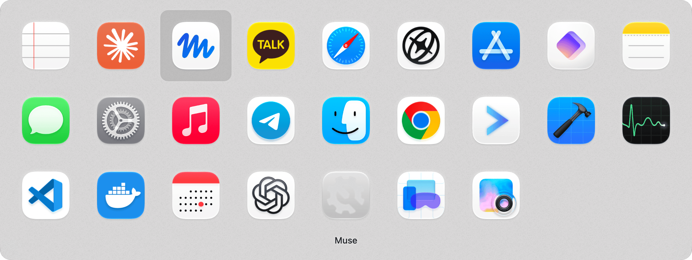

### Tutorial

A built-in tutorial walks through every feature with its keys, options and screenshots. It opens once after setup, and you can open it again any time from Settings → General → **Tutorial**.

## Keyboard reference

**App Menus**

| Key | Action |
|---|---|
| <kbd>↑</kbd> / <kbd>↓</kbd> | Choose an item |
| <kbd>→</kbd> | Open the submenu |
| <kbd>←</kbd> | Go back |
| <kbd>Return</kbd> or <kbd>Space</kbd> | Run the item |
| <kbd>Esc</kbd> | Close |

**App Menus, Outline layout**

| Key | Action |
|---|---|
| <kbd>↑</kbd> / <kbd>↓</kbd> | Choose an item |
| <kbd>→</kbd> / <kbd>←</kbd> | Expand / collapse a menu (while searching, <kbd>→</kbd> shows the result in the tree) |
| Type letters | Search every menu item |
| <kbd>Return</kbd> | Run the item, or open or close a menu |
| <kbd>Esc</kbd> | Clear the search, then close |

**Menu Bar Icons**

| Key | Action |
|---|---|
| Arrow keys | Choose an icon |
| Type letters | Search icons by name |
| <kbd>Space</kbd> | Left click the icon |
| <kbd>Return</kbd> | Right click the icon |
| <kbd>Esc</kbd> | Close |

The Space and Return click assignments can be swapped in Settings. The pointer works in both popups too.

**⌘Tab app switcher** (while holding <kbd>⌘</kbd>)

| Key | Action |
|---|---|
| <kbd>Tab</kbd> | Open the switcher, then go to the next app |
| <kbd>⇧</kbd><kbd>Tab</kbd> or <kbd>`</kbd> | Go to the previous app |
| Arrow keys | Move along a row and between rows |
| Let go of <kbd>⌘</kbd> | Switch to the selected app |
| <kbd>Esc</kbd> | Cancel |
| <kbd>Q</kbd> / <kbd>H</kbd> | Quit / hide the selected app |

## Settings highlights

  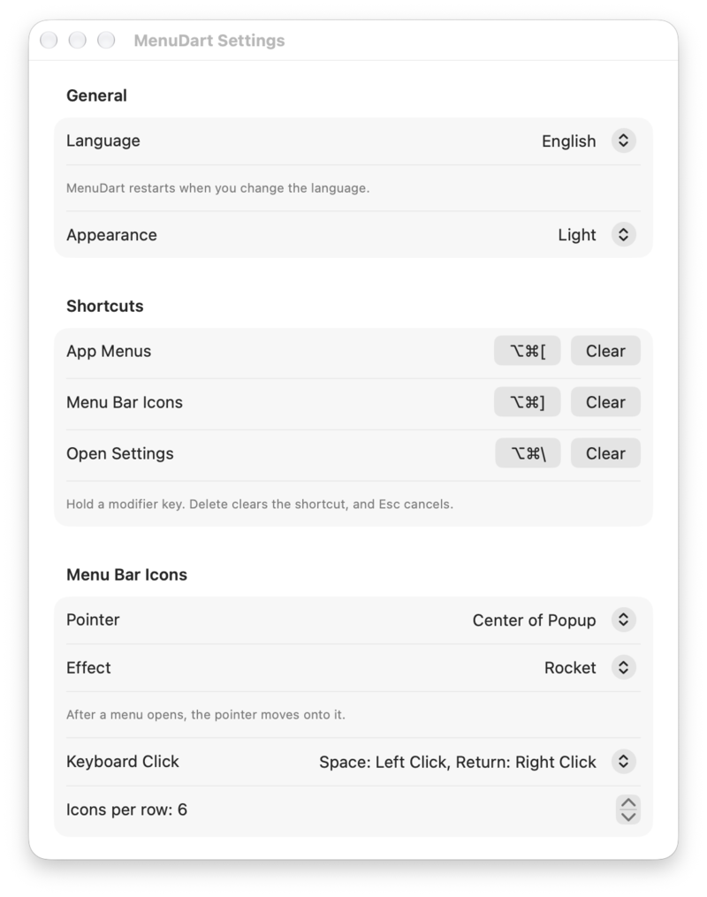

- **Shortcuts.** There are none until you set them. The setup guide offers one-click defaults: <kbd>⌥</kbd><kbd>⌘</kbd><kbd>[</kbd> for App Menus, <kbd>⌥</kbd><kbd>⌘</kbd><kbd>]</kbd> for Menu Bar Icons, and an optional <kbd>⌥</kbd><kbd>⌘</kbd><kbd>\\</kbd> for Settings. You can record any combination that includes at least one modifier key.
- **Conflict check.** MenuDart warns you if a combination is already used by another MenuDart action or a macOS system shortcut, and lets you move it, register it anyway, or cancel.
- **App Menu layout.** Classic opens submenus in columns side by side; Outline shows every menu in one tree with search.
- **⌘Tab app switcher.** Off by default. Turn on **Use MenuDart for ⌘Tab** in Settings → Shortcuts to use MenuDart's multi-row switcher instead of the macOS one.
- **Tutorial.** Settings → General → **Tutorial** opens the feature tutorial again.
- **Menu Bar Icons grid.** Set the number of icons per row (3 to 15), where the pointer lands when the popup opens (center of the first item or center of the popup), and whether icon names are shown.
- **Pointer effect.** Rocket, Trail, Dart, Ddoee (a flying cat), or No Effect. Set its speed (50–200%) and size (50–300%).
- **Appearance and theme.** System, Light, or Dark, plus a **Theme** for the popups and Settings: **Classic** looks like macOS menus, and **Smoke** is smoked glass that lets what's behind show through, blurred, with a lit edge and a glossy selection. A **Transparency** slider sets how much shows through. In Smoke, Menu Bar Icons shows the icons alone, like the Dock.

  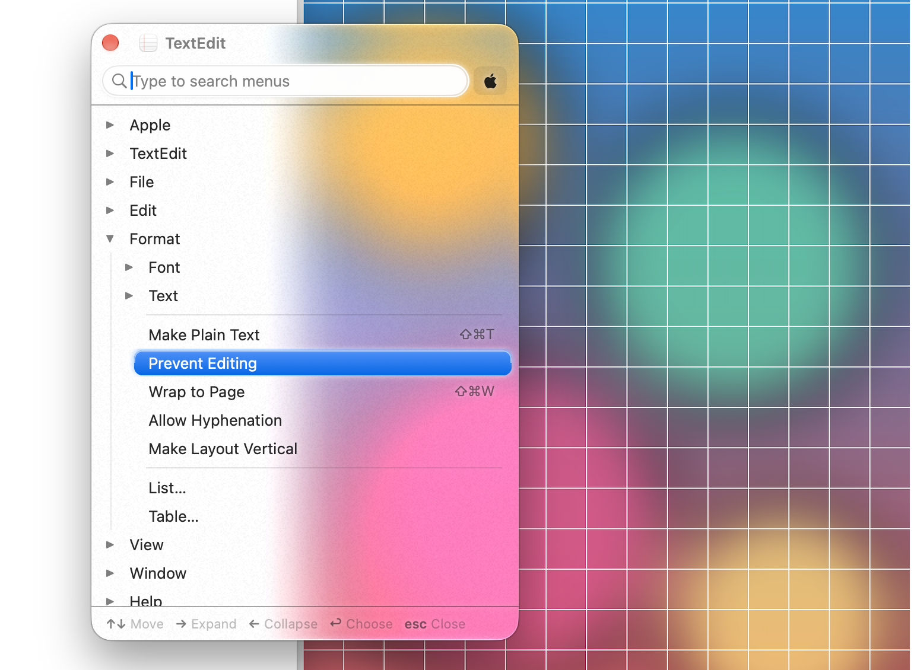

- **Language.** English, Korean, Japanese, Simplified Chinese, Traditional Chinese, Portuguese (Brazil), Spanish, Hindi, Italian, German and French. The app restarts when you change it.

## Requirements and permissions

- macOS 14.0 or later
- Universal app (Apple silicon and Intel)

| Permission | Required? | What it's for | Without it |
|---|---|---|---|
| Accessibility | Yes | Reading the front app's menus, pressing menu bar icons, and the optional ⌘Tab switcher | Neither popup (nor the ⌘Tab switcher) works |
| Screen Recording | Recommended, optional | Showing the real menu bar icon images in the grid | The grid shows each app's own icon instead |

MenuDart captures only the menu bar icons it shows in the popup. It doesn't save those images or send them anywhere. MenuDart doesn't collect or send your data; the only network request is the update check, which contacts GitHub to fetch the update feed.

A step-by-step setup guide runs on first launch and covers permissions and shortcuts in about two minutes.

## Install

1. Download the latest `MenuDart-x.y.z.dmg` from [Releases](https://github.com/studiojin-dev/MenuDart-Public/releases).
2. Open the `.dmg` and drag MenuDart to the Applications folder.
3. Launch MenuDart and follow the setup guide.

MenuDart is signed with a Developer ID and notarized by Apple. It is distributed directly from this page, not through the Mac App Store. To update, choose **Check for Updates…** from the MenuDart icon in the menu bar.

## FAQ

### How do I allow Accessibility?

Open System Settings › Privacy & Security › Accessibility and turn on MenuDart. The setup guide walks you through this on first launch. Accessibility is required for both popups.

### How do I allow Screen Recording?

Open System Settings › Privacy & Security › Screen & System Audio Recording and turn on MenuDart. **Restart MenuDart afterward**, because the change only takes effect after a restart.

If the switch is on but MenuDart still shows "Needed", open Settings › Permissions › Setup Guide and choose **Reset and Request Again**.

### macOS says MenuDart is from an unidentified developer. Is it safe?

MenuDart is signed with a Developer ID and notarized by Apple, so it should open normally. If macOS still blocks it, open System Settings › Privacy & Security and choose **Open Anyway**. Also make sure you downloaded the app from the official [Releases](https://github.com/studiojin-dev/MenuDart-Public/releases) page.

### Which macOS versions are supported?

macOS 14.0 or later, on both Apple silicon and Intel Macs.

### An icon's menu still opens at the top of the screen. Is that a bug?

No. The icon's menu opens where the app and macOS put it, and MenuDart doesn't relocate it. What MenuDart does is move your pointer onto the menu after it opens, so you don't have to reach for it.

### Does MenuDart hide or rearrange my menu bar icons?

No. MenuDart doesn't change your menu bar at all. It shows what's there in a popup.

## Support

Found a bug or have a question? Please open an issue on [GitHub Issues](https://github.com/studiojin-dev/MenuDart-Public/issues). It helps to include your macOS version and your MenuDart version.

## License agreement

Using MenuDart requires agreeing to the [End User License Agreement](EULA.md) ([한국어](EULA.ko.md)). MenuDart asks for this on first launch. A 14-day free trial is available before purchase, so purchases aren't refundable for change of mind; see Section 7 of the agreement for refunds when MenuDart doesn't work as described.

## Privacy

MenuDart has no accounts, analytics, advertising, tracking or cookies. Your menus and menu bar icons are read on your Mac and never leave it. MenuDart goes online only to check for updates, to check your license and, before you buy, to check for a running sale. See the [Privacy Policy](PRIVACY.md) ([한국어](PRIVACY.ko.md)) for details.

## Business information

Studiojin (스튜디오진) · Representative: Jeongjin Kim  
Business registration number: 730-50-01333 · Mail-order business registration number: 2026-화성병점-0744  
407Ho-B16, 59 Yeongtong-ro, Byeongjeom-gu, Hwaseong-si, Gyeonggi-do, 18337, Republic of Korea  
support@studiojin.dev

---

© 2026 Studiojin
